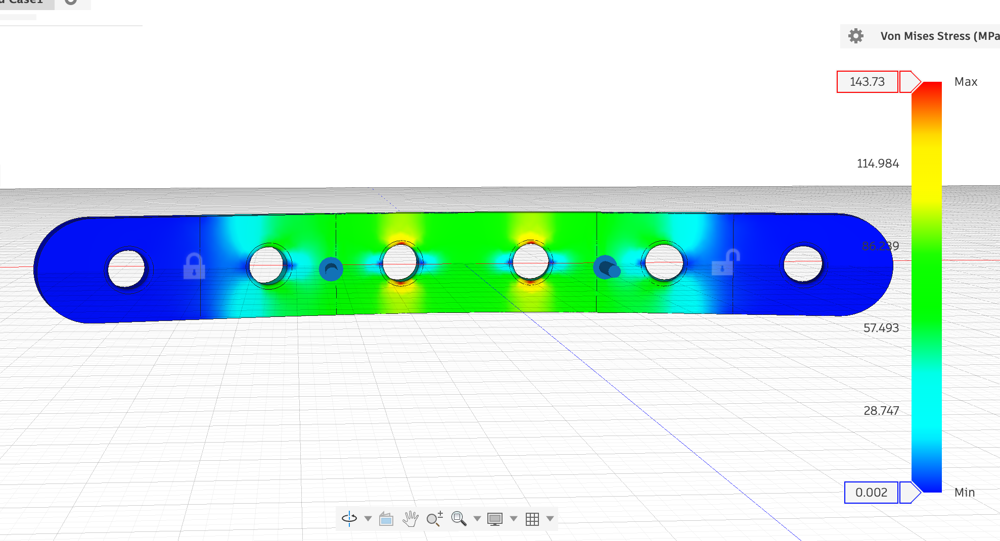
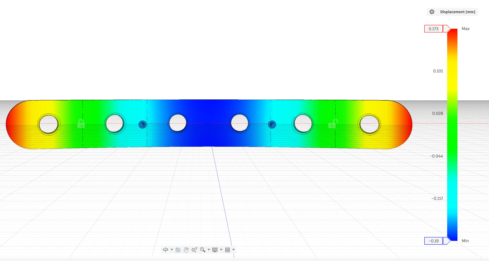
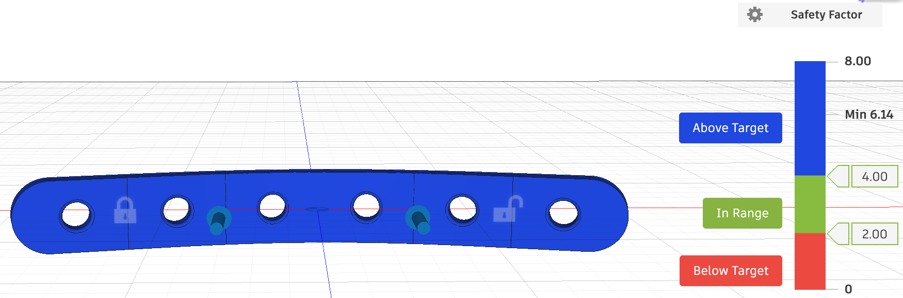

# Bone Fracture Fixation Plate: Four-Point Bending FEA

CAD model and finite element analysis of a 6-hole straight bone plate in Ti-6Al-4V, loaded in four-point bending with a setup adapted from ASTM F382 (the standard test method for metallic bone plates).

**Tools:** Autodesk Fusion (Design + Simulation, Static Stress study)

## Key Results

| Result | Value | Location |
|---|---|---|
| Max von Mises stress | **143.7 MPa** | Edges of the two innermost screw holes |
| Minimum factor of safety (yield) | **6.14** | Same as above |
| Max midspan deflection (Z) | **0.19 mm** | Center of plate |
| End lift (overhang, Z) | 0.17 mm | Plate tips beyond supports |

**Main finding:** the highest stress is at the screw holes nearest the center, not in the solid material at mid-span. The holes act as stress risers, roughly doubling the local stress compared with the solid sections between them.

## Geometry

| Parameter | Value |
|---|---|
| Length | 100 mm |
| Width | 12 mm |
| Thickness | 3.5 mm |
| Holes | 6 × Ø4.5 mm, 16 mm pitch (x = ±8, ±24, ±40 mm) |
| Ends | Full R6 rounds |
| Hole edges | 0.5 mm fillet, top and bottom |

## Material: Ti-6Al-4V (Fusion library)

| Property | Value |
|---|---|
| Young's modulus | 113.8 GPa |
| Poisson's ratio | 0.35 |
| Yield strength | 882.5 MPa |
| Ultimate tensile strength | 1034.2 MPa |
| Density | 4.43 g/cm³ |

## Test Setup

Four-point bending, adapted from ASTM F382.

- **Supports (bottom face):** lines at x = ±32 mm (64 mm support span)
- **Load points (top face):** lines at x = ±16 mm (32 mm load span)
- **Load:** 100 N at each load line (200 N total), applied in −Z
- **Boundary conditions:** one support line fixed in X, Y and Z (pin); the other fixed in Z only (roller), so the plate can slide as it bends instead of being artificially stiffened
- **Mesh:** model-based element size, 1%

Every contact line sits in the gap between two holes. An 80 mm support span would have placed the supports directly on the outermost hole centers, so the span was reduced to 64 mm. Contact lines were created with offset construction planes and Split Face.

## Hand-Calculation Check

Between the load points the bending moment is constant:

M = P · a = 100 N × 16 mm = **1600 N·mm**

**Stress at a hole (net section).**
Net width = 12 − 4.5 = 7.5 mm
Section modulus Z_net = 7.5 × 3.5² / 6 = 15.3 mm³
Nominal stress = 1600 / 15.3 = **104.5 MPa**
FEA peak = 143.7 MPa, an implied stress concentration factor of about **1.4** on the net section.

**Stress in the solid section.**
Z_gross = 12 × 3.5² / 6 = 24.5 mm³
Stress = 1600 / 24.5 = **65.3 MPa**
The peak at the hole is about **2.2×** this value.

**Midspan deflection (solid plate, beam theory).**
I = 12 × 3.5³ / 12 = 42.9 mm⁴
δ = P·a·(3L² − 4a²) / (24·E·I) = **0.15 mm**
FEA = 0.19 mm. The FEA value is higher because the six holes make the real plate less stiff than a solid bar.

The FEA results agree with beam theory in magnitude and trend.

## More Results

**Vertical (Z) displacement.** The middle sags 0.19 mm while the ends tip up 0.17 mm past the supports.

**Factor of safety.** The minimum is 6.14, well above the 4.0 target, so the whole plate shows blue.

## Limitations

- Linear static analysis; no plasticity, contact or screws.
- Supports and loads are idealized as line contacts rather than modeled rollers.
- The plate is analyzed alone, not attached to bone.
- No formal mesh convergence study yet.
- The setup is adapted from ASTM F382 and is not a full implementation of the standard.

## Next Steps

- Thickness study: rerun at 3.0 and 4.0 mm and compare peak stress and deflection
- Mesh convergence check at the innermost holes
- Compare hole designs (e.g. countersunk or locking holes)
